# Modelo de datos

Modelo conceptual y lógico de los datos de cada servicio. Los scripts y esquemas ejecutables viven en [`database/`](../../database/) y en cada servicio (las migraciones).

## PostgreSQL (D-13)

Una instancia y una base de datos compartidas, con un esquema y un usuario por servicio. Cada usuario solo tiene permisos sobre su esquema.

| Esquema | Usuario | Servicio | Migraciones | Estado |
|---|---|---|---|---|
| `auth` | `auth_service` | Auth | `services/auth/migrations/` (SQLx) | Migración inicial lista; hoy se conecta con el superusuario (T-04) |
| `core` | `core_service` | Core | `services/core/priv/repo/migrations/` (Ecto) | ERD en borrador (abajo); migraciones pendientes |
| `files` | `files_service` | File Service | Dentro del servicio | Pendiente |
| `reports` | `reports_service` | Report Service | Dentro del servicio | Pendiente |

Los nombres de usuario son una propuesta; los define el script de inicialización de [`database/postgres/`](../../database/postgres/) (tarea T-04).

### Esquema `auth`

Implementado en `services/auth/migrations/0001_initial_auth_schema.sql`:

| Tabla | Propósito |
|---|---|
| `accounts` | Identidad: correo (`citext`), verificación y estado administrativo |
| `password_credentials` | Hash de contraseña; existe solo si la cuenta puede entrar con contraseña |
| `oauth_identities` | Identidades de Google vinculadas a una cuenta |
| `sessions` | Una sesión activa por `(cuenta, tipo de cliente)`; se abre con `auth.open_session()` (D-12) |
| `refresh_tokens` | Tokens de renovación con rotación y detección de reutilización |
| `one_time_tokens` | Códigos de verificación, cambio de correo y recuperación de contraseña |
| `email_change_requests` | Solicitudes de cambio de correo pendientes |

Pendiente en Auth: tablas o columnas de perfil (nombre visible e identificador de la foto predefinida, D-06) e intentos fallidos.

### Esquema `core`

Diagrama entidad-relación del esquema `core`, usuario `core_service` (D-13). Las decisiones que lo justifican son D-17 a D-28, todavía en borrador en [core-decisions-draft.md](core-decisions-draft.md); se agruparán en el ADR-008. El detalle de columnas está en [core-erd-input.md](core-erd-input.md).

Leyenda:

- Línea continua: FK declarada dentro del esquema `core`, sin `ON DELETE CASCADE` (grupos y canales se borran de forma lógica, D-19).
- Línea punteada: referencia lógica sin FK. Usuarios (`auth.accounts.id`, D-13), mensajes en ScyllaDB y archivos del File Service.
- Entidades en mayúsculas (`AUTH_ACCOUNTS`, `SCYLLA_MESSAGES_BY_CHANNEL`, `FILES_OBJECTS`): externas, fuera del esquema `core`.
- Claves `uuid` salvo las tablas de unión, con clave compuesta. Horas en `timestamptz` (UTC).

```mermaid
erDiagram
    %% ===== CommunityService =====
    groups {
        uuid id PK
        text name "NOT NULL, 2-100"
        text description "NULL, max 500"
        uuid image_id "NULL, archivo de Files, sin FK"
        uuid created_by "usuario, sin FK"
        timestamptz archived_at "NULL = activo; fecha = solo lectura"
        timestamptz deleted_at "NULL = vigente"
        timestamptz created_at
        timestamptz updated_at
    }

    group_members {
        uuid group_id PK, FK
        uuid user_id PK "usuario, sin FK"
        group_role role "default member"
        timestamptz joined_at
    }

    group_role_permissions {
        uuid group_id PK, FK
        group_role role PK
        text permission PK "CHECK catalogo cerrado"
        boolean enabled
    }

    channels {
        uuid id PK
        uuid group_id FK
        text name "1-80, ^[a-z0-9-]+$, UNIQUE parcial"
        text description "NULL, max 500"
        channel_type type "text | voice"
        group_role min_role "default member (D-17)"
        timestamptz deleted_at "NULL = vigente"
        timestamptz created_at
        timestamptz updated_at
    }

    invitations {
        uuid id PK
        uuid group_id FK
        text code UK
        uuid created_by "usuario, sin FK"
        timestamptz expires_at "default now() + 7 d; 1 h - 30 d"
        integer max_uses "NULL = ilimitado; 1-100"
        integer uses "default 0; <= max_uses"
        timestamptz revoked_at "NULL = vigente"
        timestamptz created_at
    }

    group_bans {
        uuid group_id PK, FK
        uuid user_id PK "usuario, sin FK"
        uuid banned_by "usuario, sin FK"
        text reason "NULL"
        timestamptz created_at
    }

    moderation_actions {
        uuid id PK
        uuid group_id FK
        uuid actor_id "usuario, sin FK"
        uuid target_user_id "usuario, sin FK"
        moderation_action action "delete_message | kick | ban | unban"
        text target_ref "NULL; channel_id:message_id"
        text reason "NULL"
        timestamptz created_at "solo INSERT"
    }

    %% ===== ProjectService =====
    projects {
        uuid id PK
        uuid group_id FK
        text name "2-100, UNIQUE parcial"
        text description "NULL, max 500"
        date target_date "NULL"
        uuid created_by "usuario, sin FK"
        timestamptz archived_at "NULL = activo"
        timestamptz created_at
        timestamptz updated_at
    }

    tasks {
        uuid id PK
        uuid project_id FK
        text title "1-200"
        text description "NULL"
        task_status status "default pending"
        uuid assignee_id "NULL; usuario, sin FK"
        date due_date "NULL"
        uuid created_by "usuario, sin FK"
        integer version "default 1; bloqueo optimista"
        timestamptz status_changed_at "NULL"
        timestamptz created_at
        timestamptz updated_at
    }

    %% ===== NotificationService =====
    notifications {
        uuid id PK
        uuid recipient_id "usuario, sin FK"
        uuid group_id FK "NULL"
        text type "message.reply, task.assigned, ..."
        jsonb payload "solo referencias"
        timestamptz read_at "NULL = no leida"
        timestamptz created_at
    }

    %% ===== Soporte =====
    user_profiles {
        uuid user_id PK "auth.accounts.id, sin FK"
        text display_name
        text avatar_id "NULL"
        account_status account_status "active | suspended | deleted"
        bigint version "solo se aplica una mayor"
        timestamptz updated_at
    }

    outbox_events {
        uuid event_id PK "estable entre reintentos"
        text type "clave de ruteo"
        integer version
        uuid correlation_id "NULL"
        timestamptz occurred_at
        jsonb payload
        timestamptz published_at "NULL = pendiente"
    }

    processed_events {
        uuid event_id PK
        text type
        timestamptz processed_at "retencion 30 d (D-26)"
    }

    %% ===== Externas =====
    AUTH_ACCOUNTS {
        uuid id PK "esquema auth"
    }

    SCYLLA_MESSAGES_BY_CHANNEL {
        uuid channel_id PK "particion (1/2)"
        int bucket PK "particion (2/2), AAAAMM"
        timeuuid message_id PK "clustering DESC"
    }

    FILES_OBJECTS {
        uuid id PK "esquema files"
    }

    %% ===== FK dentro de core =====
    groups ||--|{ group_members : "tiene (>= 1 admin)"
    groups ||--|{ group_role_permissions : "configura"
    groups ||--o{ channels : "contiene"
    groups ||--o{ invitations : "emite"
    groups ||--o{ group_bans : "bloquea"
    groups ||--o{ moderation_actions : "audita"
    groups ||--o{ projects : "agrupa"
    projects ||--o{ tasks : "contiene"
    groups |o--o{ notifications : "contexto opcional"

    %% ===== Referencias logicas, sin FK =====
    AUTH_ACCOUNTS ||..o| user_profiles : "user.updated (D-20)"
    user_profiles |o..o{ group_members : "user_id"
    user_profiles |o..o{ group_bans : "user_id"
    user_profiles |o..o{ moderation_actions : "actor_id / target_user_id"
    user_profiles |o..o{ tasks : "assignee_id"
    user_profiles |o..o{ notifications : "recipient_id"
    channels ||..o{ SCYLLA_MESSAGES_BY_CHANNEL : "channel_id"
    FILES_OBJECTS |o..o{ groups : "image_id"
```

`outbox_events` y `processed_events` no se relacionan con otras tablas: el primero se escribe en la misma transacción que el cambio de dominio (D-21) y el segundo deduplica `user.updated` y `session.revoked`.

Otras columnas de usuario sin FK que no se dibujan para no saturar el diagrama: `groups.created_by`, `invitations.created_by`, `group_bans.banned_by`, `projects.created_by`, `tasks.created_by`.

#### Tipos enumerados

| Tipo | Valores |
|---|---|
| `group_role` | `member` < `moderator` < `admin` (el orden del `ENUM` permite comparar) |
| `channel_type` | `text`, `voice` |
| `task_status` | `pending`, `in_progress`, `done` |
| `account_status` | `active`, `suspended`, `deleted` |
| `moderation_action` | `delete_message`, `kick`, `ban`, `unban` |

`permission` no es tabla ni `ENUM`: `CHECK` sobre el catálogo cerrado (`group.manage`, `roles.manage`, `channels.manage`, `invitations.manage`, `members.moderate`, `messages.moderate`, `projects.manage`, `tasks.assign`).

#### Restricciones que el diagrama no muestra

| Tabla | Restricción o índice | Origen |
|---|---|---|
| `group_members` | Índice `(user_id)` | Listar grupos de un usuario |
| `channels` | `UNIQUE (group_id, name) WHERE deleted_at IS NULL` | D-19 |
| `invitations` | `CHECK (max_uses IS NULL OR uses <= max_uses)`; `UNIQUE (code)` | D-22, CU-11 |
| `moderation_actions` | Índice `(group_id, created_at DESC)` | CU-15 |
| `projects` | `UNIQUE (group_id, name) WHERE archived_at IS NULL` | CU-25 |
| `tasks` | Índices `(project_id, status)` y `(assignee_id)` | CU-27, CU-28 |
| `notifications` | Índices `(recipient_id, created_at DESC)` y `(recipient_id) WHERE read_at IS NULL` | D-23 |
| `outbox_events` | Índice `(occurred_at) WHERE published_at IS NULL` | D-21 |
| `processed_events` | Índice `(processed_at)` | D-26 |

Invariantes que se validan en transacción y no con restricciones declarativas: al menos un `admin` por grupo no borrado (bloqueo `FOR UPDATE` del grupo); uso de invitación con `UPDATE ... WHERE uses < max_uses RETURNING` más el `INSERT` de la membresía; `tasks.assignee_id` miembro del grupo; actor de moderación con rol estrictamente superior al afectado.

## ScyllaDB (D-05)

Mensajes y reacciones de Core. Los esquemas CQL viven en [`database/scylla/`](../../database/scylla/), numerados en orden de aplicación.

| Necesidad | Diseño |
|---|---|
| Historial paginado por canal (CU-20) | Clave de partición `(channel_id, bucket)` con un *bucket* por mes; clave de ordenamiento `message_id` (timeuuid) descendente; cursor por el último `message_id` |
| Idempotencia (RNF-CON-01) | Tabla auxiliar por `client_message_id` con `INSERT ... IF NOT EXISTS` |
| Editar y eliminar (CU-19) | Actualizar por clave; eliminar con un indicador `deleted`, no con `DELETE`, para evitar *tombstones* |
| Reacciones (CU-18) | Una fila por `(message_id, emoji, user_id)`, contando al leer. **No usar** el tipo `counter`, porque no es idempotente |
| Desarrollo | Un nodo, factor de replicación 1, consistencia `ONE`, memoria acotada |
| Driver de Elixir | Xandra |

Tablas del *keyspace* `sonimbus_core`:

| Tabla | Clave primaria | Uso |
|---|---|---|
| `messages_by_channel` | `((channel_id, bucket), message_id DESC)`; `bucket` es `AAAAMM` (UTC) calculado del `message_id` | Historial (CU-20), respuestas con `reply_to` (CU-17), adjunto con `file_id` (CU-23), edición con `edited_at` y borrado lógico con `deleted`, `deleted_reason` y `deleted_by` (CU-19, D-24) |
| `messages_by_client_id` | `((author_id, client_message_id))`, TTL de 7 días | Reserva con `INSERT ... IF NOT EXISTS` antes de guardar el mensaje (CU-16 FA-02) |
| `reactions_by_channel` | `((channel_id, bucket), message_id DESC, emoji, user_id)` | Reacciones de una página del historial en una sola consulta; retirar es `active = false` (CU-18) |

## Redis

| Uso | Servicio |
|---|---|
| Sesiones e intentos fallidos | Auth |
| Presencia y caché de permisos | Core |

## MinIO

Contenido de los archivos y vistas previas, propiedad del File Service. Los metadatos (nombre, tipo, tamaño, autor, canal y estado) van en el esquema `files` de PostgreSQL.
